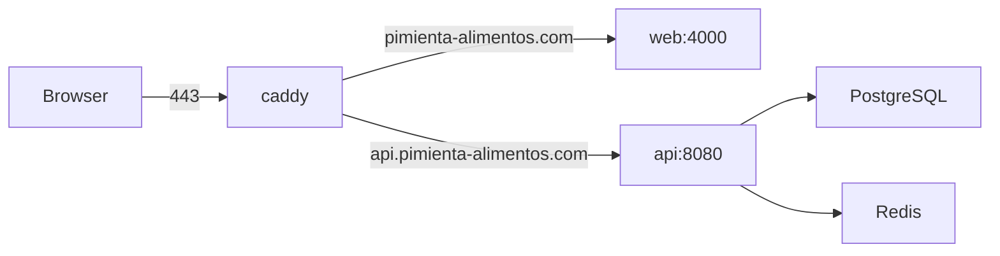

# Production host

Web and API run together on one Amazon Linux 2023 EC2 instance. Caddy terminates HTTPS and reverse-proxies the two Compose services. PostgreSQL and Redis are not containers on this host; the API reaches them through `POSTGRES_URL` and `REDIS_URL` in the host `.env`. Redis uses TLS (`rediss`) on port `6379`.

The directory `/home/ec2-user/pimienta` contains only `.env`, `Caddyfile`, and `docker-compose.yml`. Those files are not checked into this repository. No other Compose project and no Alloy container are running on the instance. Snapshots below match that directory as of 9 Nov 2026.

## Host

| | |
| --- | --- |
| OS | Amazon Linux 2023 |
| Public IPv4 | `3.226.188.206` |
| Private hostname | `ip-172-31-77-220` |
| SSH user | `ec2-user` |
| App directory | `/home/ec2-user/pimienta` |
| Compose project | `pimienta` |

From a machine that has the instance key (kept outside the repo, for example `~/Documents/pim-key.pem`):

```sh
ssh -i "pim-key.pem" ec2-user@3.226.188.206
cd ~/pimienta
```

GitHub Actions uses the same host with secrets `SSH_HOST`, `SSH_USER`, and `SSH_PRIVATE_KEY`. It does not use Cloudflare Access. `WEB_DEPLOY_PATH` and `BACKEND_DEPLOY_PATH` are this directory.

## Traffic



Public names:

- `https://pimienta-alimentos.com` → container `web` port `4000`
- `https://api.pimienta-alimentos.com` → container `api` port `8080`

`ALLOWED_HOSTS` also lists `www.pimienta-alimentos.com`, `localhost`, and `127.0.0.1`. The Caddyfile has no `www` site block.

Caddy obtains and renews certificates on its own and stores them in the `caddy_data` volume. There is no manual TLS block in the Caddyfile.

The API container publishes `8080` on `0.0.0.0` and `::`. `docker ps` also shows `8027/tcp` exposed on that container and not mapped to the host. Nothing on this host publishes the Actuator port, and the Caddyfile does not route it. See [observability.md](observability.md).

## Caddyfile

`/home/ec2-user/pimienta/Caddyfile`:

```caddyfile
pimienta-alimentos.com {
        reverse_proxy web:4000
}

api.pimienta-alimentos.com {
        reverse_proxy api:8080
}
```

`web` and `api` are Compose DNS names on the project network, not host ports.

## Compose

`/home/ec2-user/pimienta/docker-compose.yml`:

```yaml
name: pimienta

services:
  caddy:
    image: caddy:2-alpine
    restart: unless-stopped
    ports:
      - "80:80"
      - "443:443"
    volumes:
      - ./Caddyfile:/etc/caddy/Caddyfile:ro
      - caddy_data:/data
      - caddy_config:/config
    depends_on:
      - web
      - api

  web:
    image: ghcr.io/alexistrejo11/pimienta-alimentos/web:latest
    restart: unless-stopped
    ports:
      - "127.0.0.1:4000:4000"
    env_file: .env
    environment:
      PORT: "4000"
      API_BASE_URL: ${API_BASE_URL}
      ALLOWED_HOSTS: ${ALLOWED_HOSTS}
    depends_on:
      - api

  api:
    image: ghcr.io/alexistrejo11/pimienta-alimentos/backend:latest
    restart: unless-stopped
    ports:
      - "${API_PORT}:${API_PORT}"
    env_file: .env
    environment:
      POSTGRES_USER: ${POSTGRES_USER}
      POSTGRES_PASSWORD: ${POSTGRES_PASSWORD}
      REDIS_URL: ${REDIS_URL}
      JAVA_TOOL_OPTIONS: >-
        -XX:MaxRAMPercentage=75.0
        -XX:InitialRAMPercentage=50.0
        -XX:+UseSerialGC
        -XX:+ExitOnOutOfMemoryError
      SPRING_DATASOURCE_HIKARI_MAXIMUM_POOL_SIZE: "5"
      SPRING_DATASOURCE_HIKARI_MINIMUM_IDLE: "1"
      SERVER_TOMCAT_THREADS_MAX: "20"
      SERVER_TOMCAT_THREADS_MIN_SPARE: "2"
      SERVER_TOMCAT_MAX_CONNECTIONS: "100"
    deploy:
      resources:
        limits:
          memory: 1024m

volumes:
  caddy_data:
  caddy_config:
```

Images are `ghcr.io/alexistrejo11/pimienta-alimentos/web:latest` and `ghcr.io/alexistrejo11/pimienta-alimentos/backend:latest`. A push to `main` also tags the same images with the commit SHA. Workflows: `.github/workflows/web-ci-cd.yml` and `.github/workflows/backend-ci-cd.yml`.

The API container is limited to 1024 MiB. The JVM is capped with `MaxRAMPercentage` and uses the serial collector so it stays inside that limit.

`web` publishes `4000` on loopback only. `caddy` publishes `80` and `443` on all interfaces. `API_PORT` is `8080`, and `api` publishes that port on all interfaces. Public clients still enter through Caddy on `api.pimienta-alimentos.com`.

Running containers (`docker compose ps`):

| Name | Image | Notes |
| --- | --- | --- |
| `pimienta-caddy-1` | `caddy:2-alpine` | `0.0.0.0:80`, `0.0.0.0:443` |
| `pimienta-web-1` | `ghcr.io/alexistrejo11/pimienta-alimentos/web:latest` | `127.0.0.1:4000` |
| `pimienta-api-1` | `ghcr.io/alexistrejo11/pimienta-alimentos/backend:latest` | `0.0.0.0:8080`, unpublished `8027/tcp` |

## Environment file

`/home/ec2-user/pimienta/.env` is loaded by both `web` and `api` and is also interpolated by Compose. It is not in git. Values below are the non-secret ones read from the host; credentials stay on the instance.

| Variable | Value on the host |
| --- | --- |
| `API_PORT` | `8080` |
| `API_BASE_URL` | `https://api.pimienta-alimentos.com/api/v1` |
| `ALLOWED_HOSTS` | `pimienta-alimentos.com,www.pimienta-alimentos.com,localhost,127.0.0.1` |
| `POSTGRES_DB` | `pimienta_alimentos` |
| `REDIS_URL` | external Redis, scheme `rediss`, port `6379` |

Compose interpolates `API_BASE_URL`, `ALLOWED_HOSTS`, `API_PORT`, `POSTGRES_USER`, `POSTGRES_PASSWORD`, and `REDIS_URL`. The file also defines these names. Their values are not recorded here:

`PORT`, `JAVA_OPTS`, `SPRING_PROFILES_ACTIVE`, `POSTGRES_URL`, `POSTGRES_USER`, `POSTGRES_PASSWORD`, `PIMIENTA_REDIS_KEY_PREFIX`, `PIMIENTA_CORS_ALLOWED_ORIGINS`, `PIMIENTA_SECURITY_JWT_SECRET`, `PIMIENTA_BOOTSTRAP_ADMIN_ENABLED`, `PIMIENTA_BOOTSTRAP_ADMIN_EMAIL`, `PIMIENTA_BOOTSTRAP_ADMIN_PASSWORD`, `PIMIENTA_BOOTSTRAP_ADMIN_FIRST_NAME`, `PIMIENTA_BOOTSTRAP_ADMIN_LAST_NAME`, `PIMIENTA_BOOTSTRAP_ADMIN_PHONE`, `AWS_ACCESS_KEY_ID`, `AWS_SECRET_ACCESS_KEY`, `AWS_REGION`, `AWS_S3_BUCKET_NAME`, `AWS_S3_ENDPOINT`, `AWS_S3_PUBLIC_ENDPOINT`, `AWS_S3_FOLDER`, `AWS_S3_SOURCES_ROOT`, `AWS_S3_POS_APK_KEY`, `AWS_S3_POS_APK_MANIFEST_KEY`.

`POSTGRES_URL` is a JDBC URL to a database outside this Compose file. The collection command did not print that host.

## What a deploy does

A push to `main` that changes `web/` or `backend/` builds a multi-arch image, pushes it to GHCR, then SSHs to this host.

On the instance the job:

1. `cd`s to the deploy path.
2. Logs in to `ghcr.io` with `GHCR_TOKEN`.
3. Pulls and recreates only its service: `docker compose pull web` then `docker compose up -d --remove-orphans web`, or the same pair for `api`.
4. Deletes unused image IDs for that repository and logs out of GHCR.

Caddy is not recreated by either workflow. Changing the Caddyfile or Compose file is a manual edit on the host, followed by:

```sh
cd ~/pimienta
docker compose up -d
```

Useful checks after a deploy:

```sh
docker compose ps
docker compose logs --tail=100 api
docker compose logs --tail=100 web
```
